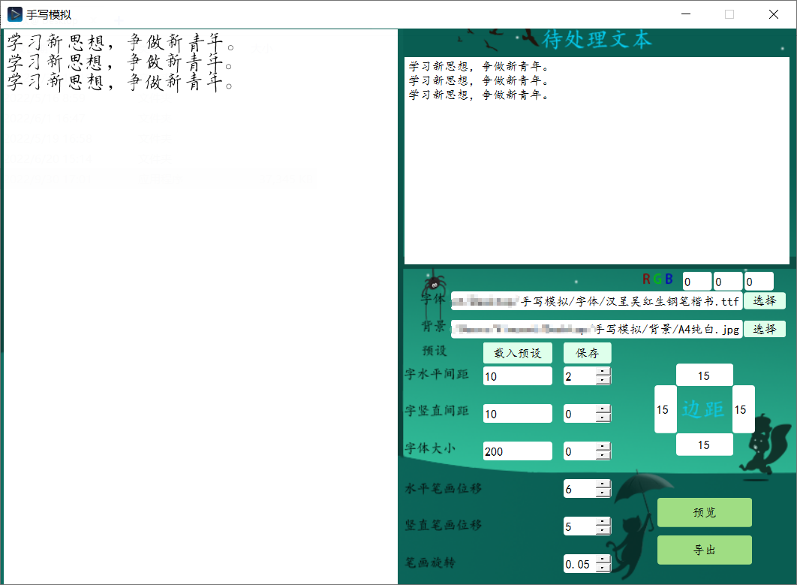

# 手写模拟 HandWrite Sim

[](https://www.python.org/)
[](https://doc.qt.io/qtforpython-6/)
[](https://github.com/Gsllchb/Handright)
[](https://www.microsoft.com/windows)
[](https://github.com/ljcddg/handwrite-sim/releases)
[](LICENSE)

> 把任意文字渲染成以假乱真的手写文档图片 —— 自定义字体、实时预览、一键批量导出。

本项目在原版「手写模拟」的基础上完成了 **界面与架构的全面重构**：从绝对定位的固定窗口改成可缩放的 Qt 布局界面，生成过程移入后台线程，并新增字体管理、实时预览、项目预设、会话记忆等能力。渲染核心仍由 [handright](https://github.com/Gsllchb/Handright) 提供。

## 界面



> 上图为重构前版本截图，新版为可缩放的布局化界面，以实际运行效果为准。

## 效果


## 功能特性

- **布局化界面**：`QSplitter` 左右分栏，窗口可自由缩放，参数分「基础排版」与「高级参数」（随机扰动、页边距）
- **TTF 字体管理**：一键导入本地 TTF/OTF 到 `Fonts/`，下拉快速切换，可删除；自动读取字体真实名称
- **两步确认工作流**：先「预览」一页确认效果，满意后再「确认效果并导出」全部页面，避免白等几十页
- **参数实时预览**：调整间距 / 行距 / 字号 / 文本后左侧自动重渲染（0.4 秒防抖），可一键关闭以适配长文档
- **背景即时预览**：选定背景图片后立即展示在预览区
- **项目预设**：预设以 JSON 持久化在 `presets/` 目录，下拉即点即用，支持保存 / 删除 / 导入 / 导出
- **会话自动记忆**：参数与草稿文本自动保存（`presets/.last_session.json`），下次启动自动恢复
- **后台线程生成**：渲染期间界面不卡死，状态栏实时显示进度与页码
- **兼容旧预设**：JSON 预设按参数名存储（不再依赖行序），同时兼容旧版 18 行文本预设
- **页数预估**：输入时实时显示字数与预计页数
- **取色器**：`QColorDialog` 可视化选色，替代手输 RGB
- **导出不覆盖**：每次导出到 `output/时间戳/` 独立目录，完成后可直接打开输出目录

## 本次重构更新

相对原版（`main.py` + Qt Designer 绝对定位界面）的主要变化：

| 模块 | 原版 | 当前版本 |
|------|------|----------|
| 界面 | `setGeometry` 绝对定位，窗口锁死 848×592 | Qt 布局管理 + QSS 主题，可自由缩放 |
| 标签 | 文字烘焙在背景图 `night.png` 里 | 真实 `QLabel` / `QGroupBox`，不再依赖背景图 |
| 生成 | 在 UI 线程同步执行，长文本卡死 | `QThread` 后台渲染，信号回传进度 |
| 字体 | 每次弹文件对话框选路径 | 扫描 `Fonts/` 下拉选择，支持导入 / 删除 |
| 预设 | 18 行纯文本按位置解析，错一位即崩溃 | JSON 按名存储，兼容旧格式，项目内持久化 |
| 预览 | 全量生成后只显示第一页 | 生成器惰性取首页，两步确认后再导出全部 |
| 参数 | 18 个参数平铺，手输数字 | 基础 / 高级两级 + 紧凑多列，SpinBox 防非法输入 |
| 错误处理 | 裸 `except` 静默吞异常 | 统一校验 + 明确报错弹窗，按钮状态保证正确 |
| 打包 | 依赖外部背景图 | 单文件 exe，字体与预设首次运行自动落到同级目录 |

## 技术栈

| 分层 | 技术 |
|------|------|
| 界面 | PySide6 / Qt 6（布局管理 + QSS 主题） |
| 渲染 | [handright](https://github.com/Gsllchb/Handright)（笔画抖动与排版） |
| 图像 | Pillow（背景读取、页面合成、格式转换） |
| 打包 | PyInstaller（单文件 exe + 资源随包） |
| CI | GitHub Actions（推送 `release` 分支自动构建发布） |

## 快速开始

### 源码运行

```powershell
py -3.12 -m venv .venv
.venv\Scripts\activate
.venv\Scripts\python.exe -m pip install --upgrade pip
.venv\Scripts\python.exe -m pip install -r requirements.txt
.venv\Scripts\python.exe .\main.py
```

环境要求：

- Windows 10 / 11，Python 3.12+
- 依赖见 `requirements.txt`（`PySide6` / `handright` / `Pillow`）

### 使用步骤

1. 在「字体」中导入或选择字体，在「背景」中选择纸张背景图
2. 在「待处理文本」中输入内容，调整基础排版与高级参数
3. 点「预览」渲染第一页，不满意可换一次随机抖动
4. 满意后点「确认效果并导出」，结果输出到 `output/时间戳/`

## 打包

```powershell
pyinstaller -F main.py --windowed --noconfirm -i "assets/ui/3d.ico" --add-data "assets/ui/3d.ico;assets/ui" --add-data "Fonts;Fonts" --add-data "background;background" --add-data "presets;presets" -n "手写模拟"
```

> 新版界面不再依赖 `assets/ui/night.png`。`Fonts`、`presets` 随包分发，首次运行时自动复制到可执行文件同级目录，之后用户导入的字体与保存的预设都持久化保存在那里。
>
> 若打包环境报 `ordlookup has no attribute ordLookup`，说明本机 `ordlookup` 依赖损坏，可执行 `pip install --force-reinstall ordlookup` 修复。

也可以交给 CI：推送到 `release` 分支（或在 Actions 页面手动触发）后，GitHub Actions 会自动构建并发布 `handwrite-sim-win64.zip`，配置见 `.github/workflows/release.yml`。

## 项目结构

```text
hand-write/
├── assets/
│   └── ui/
│       └── 3d.ico            # 应用图标（night.png 为旧版背景插画，新版已不再依赖）
├── background/
│   └── white-A4.jpeg         # 示例背景（可替换）
├── Fonts/                    # 字体库（可通过界面导入 TTF）
├── presets/                  # 项目预设（JSON，含自动记忆的 .last_session.json）
├── output/                   # 导出结果目录（运行时自动创建）
├── LICENSE
├── README.md
├── main.py                   # 程序入口与业务逻辑
├── ui.py                     # Qt 界面布局（布局管理，可缩放）
├── fontlib.py                # 字体扫描 / 导入 / 删除 / 字体名读取
├── presets.py                # JSON 预设读写（兼容旧版 18 行文本）
├── worker.py                 # 后台生成线程（handright 渲染）
├── requirements.txt
└── 预设.txt                   # 旧版预设示例（仍可载入）
```

约定与规范：

- Python 文件使用 `snake_case` 命名。
- 注释采用 NumPy 风格（模块、函数 / 方法均添加说明）。
- 使用虚拟环境进行依赖管理，依赖固定在 `requirements.txt`。

## 路线图

开发中：

- [ ] Web 前端工程：收集参数后以 API 形式发送给后端
- [ ] Flask 后端工程：接收参数后调用 handright
- [ ] 托盘图标应用：常驻任务栏右下角
- [ ] 安装包 / 压缩包发布
- [ ] 多页预览翻页（第 1/2/3 页切换）

可能实现（复杂度较高）：

- [ ] 自由排版
- [ ] 手写公式

## 作者与致谢

- **原项目**：[qingxuandaoming](https://github.com/qingxuandaoming/)（作者：WHY / Vincent Zhong），MIT License
- **界面与架构重构**：ljcddg（[@ljcddg](https://github.com/ljcddg)）
- **手写渲染核心**：[handright](https://github.com/Gsllchb/Handright)（Gsllchb）
- 字体与背景示例素材来自原项目

特别感谢原项目提供的手写渲染思路与参数体系，本项目的重构完全建立在其之上。

## 许可证

本项目基于 [MIT License](LICENSE) 开源，保留原作者的版权声明。你可以自由使用、修改与分发，包括商业用途，只需保留版权声明。

## 相关链接

- [Qt for Python 文档](https://doc.qt.io/qtforpython-6/quickstart.html)
- [handright 使用教程](https://github.com/Gsllchb/Handright/blob/master/docs/tutorial.md)
- [PyInstaller 文档](https://pyinstaller.org/en/stable/index.html)
- [GitHub Actions 文档](https://docs.github.com/zh/actions)
